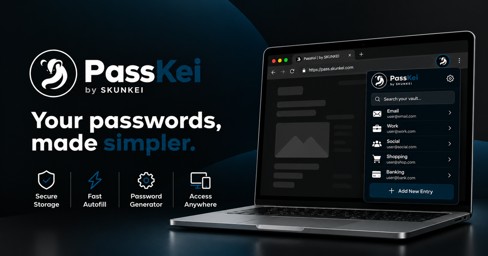
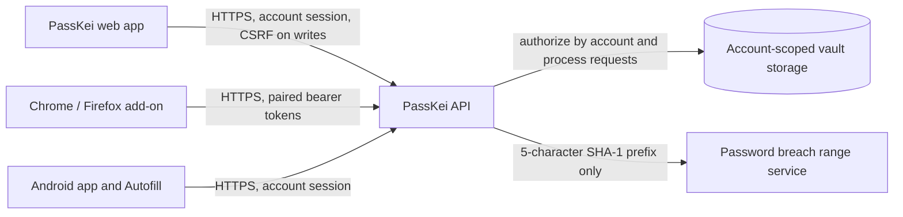

# PassKei is SKUNKEI's Password Manager

PassKei is an account-backed password vault for storing and using website credentials across the PassKei web app, Chrome, Firefox, and Android. It helps people keep logins organized, retrieve them when needed, and review basic password-strength and breach-check signals.

**PassKei is a hosted service, not a standalone or offline password manager.** Vault encryption is performed by the service: vault fields are encrypted before database storage, but the service controls the encryption keys and can decrypt data to fulfill authenticated requests. PassKei is therefore **not a zero-knowledge or end-to-end encrypted vault**. Do not use either term to describe it.

	

## Why PassKei

Account credentials are easy to lose, reuse, or leave scattered across browsers and devices. PassKei provides one account-backed place to manage logins, with explicit reveal and autofill actions, device-aware extension access, and a security overview that helps users identify entries worth reviewing.

PassKei is designed around practical safeguards: encrypted-at-rest vault fields, HTTPS transport, per-account access checks, CSRF protection for cookie-authenticated writes, short-lived/revocable extension access tokens, and audit records for sensitive vault operations. These controls reduce risk; they do not guarantee that an account or device can never be compromised.

## What It Does

### Web Vault

The PassKei web app is available at [pass.skunkei.com](https://pass.skunkei.com/). After signing in with an eligible SKUNKEI account, users can:

- View an overview of vault size, password strength, compromised-password results, favorites, and recent changes.
- Add, search, reveal, copy, update, and delete password entries containing a name, website URL, username, and password.
- Generate a password while adding or editing an entry.
- Mark entries as favorites.
- Review and restore soft-deleted entries from Trash while they remain retained.
- Associate passkey credential metadata and recovery codes with a vault entry.

The dashboard’s score and recommendations are calculated from available entry strength and breach-check fields. They are advisory signals, not an independent audit, guarantee, or full account-security assessment. The visible Import control is not currently a supported import workflow.

### Chrome and Firefox Add-ons

The browser add-ons provide a toolbar vault view, search, explicit username/password copy, site matching, inline autofill, and a user-confirmed save/update flow for credentials entered on a page. Autofill matches an exact saved host or one of its subdomains; a credential saved only for a child subdomain is not offered to its parent domain.

Each browser installation is connected separately:

1. Start pairing in the extension.
2. Enter its short-lived, one-time approval code on the signed-in PassKei website.
3. Approve only a code from a pairing you initiated.
4. The extension receives a short-lived access token and rotating refresh token. Signing out revokes that device’s token family.

Pending form credentials and passkey metadata are kept in browser-session storage, expire after ten minutes, and are cleared on sign-out or browser shutdown. Credentials are sent to PassKei for saving only after the user confirms the save action.

Current source requirements are Chrome 111 or newer and Firefox 142 or newer. Browser add-ons request page access to provide password-field detection and user-requested save/autofill; users should review those permissions and only install the official signed add-on.

### Android App

The Android client supports account sign-in, live vault CRUD, search, reveal/copy, and Android Autofill. Autofill must be enabled as the device’s selected autofill provider in Android Settings. It offers entries for HTTPS websites and requires the user to select a suggestion; save/update requests are mediated by Android’s system Autofill prompt. The app does not autofill on public HTTP sites.

The Android app currently requires Android 8.0 (API 26) or later. Production sign-in uses Google Play Integrity, so the Play-distributed, correctly signed app and a supported device are required. A locally sideloaded/debug APK may not pass production integrity verification. “Remember me” is optional; remembered session cookies are encrypted at rest with an Android Keystore key and remain subject to server-side expiry and revocation.

## How It Works

The service checks authentication and ownership on vault operations. Web and Android use account sessions; state-changing cookie-authenticated requests require CSRF protection. Browser add-ons use a separate device-approval flow and bearer tokens rather than the website’s browser cookies. Extension access tokens are short-lived; refresh tokens rotate and can be revoked by device.

Vault titles, usernames, URLs, passwords, and supported secret metadata are encrypted at rest by the service using AES-256-GCM. HMAC values support selected exact-match lookup and deduplication without indexing those values as plaintext. Account passwords are handled by the account-authentication system and are separate from the website passwords stored as vault entries.

When a password is created or changed, PassKei can check it against the Have I Been Pwned Pwned Passwords range service using the first five characters of its SHA-1 digest. The plaintext password and full digest are not sent to that service. The result is a breach indicator, not a guarantee that a password is safe.

## Security and Privacy Boundaries

- **Transport:** PassKei clients use HTTPS for production service traffic.
- **At-rest protection:** the service encrypts supported vault fields before database persistence. The service, not the user’s device alone, controls the encryption key; this is not zero-knowledge encryption.
- **Account isolation:** vault requests are scoped to the authenticated account and resource ownership is checked server-side.
- **Sensitive access:** revealing or copying a password is a separate user action and is recorded in the service’s audit history.
- **Browser access:** extension content scripts inspect password fields to offer the requested features. Pending credentials are temporary; they are not silently uploaded as saved vault entries.
- **Android protection:** the app blocks screenshots, disables cleartext traffic and Android backup, and stores optional remembered cookies encrypted using Android Keystore.
- **External checks:** breach checking sends a partial password hash prefix to its provider. Android sign-in uses Google Play Integrity. The deployed website may load configured analytics or shared presentation assets; see the live [PassKei privacy notice](https://pass.skunkei.com/privacy) for current disclosures.
- **No absolute-security claim:** protect the SKUNKEI account, device, browser profile, and recovery methods. A compromised signed-in device can expose credentials when the user reveals or fills them.

## Retention and Recovery

Deleting a vault item first moves it to Trash; it can be restored while retained. A server cleanup job permanently removes deleted entries older than 30 days. This is a recovery window, not a backup guarantee. Account password recovery is handled through the account email reset flow. If the account or service is unavailable, the hosted vault cannot be opened offline.

Passkeys linked to an entry are metadata for associating a WebAuthn credential with that login. The authenticator/browser retains the private key; PassKei stores credential metadata, not the authenticator’s private key. Recovery codes entered for an entry are encrypted as vault data; they are not automatically verified or consumed by PassKei.

## What Is Not Currently Supported

- Offline vault access or a separate local master-password vault.
- Built-in vault import/export; the web Import control is not functional yet.
- Multi-user/family/shared vaults; favorites are personal organization, not sharing.
- Automatic password changes on third-party websites.
- Android management of account profile, billing, or trusted-session settings; use PassKei Web for account settings.
- A claim that support can recover a vault independently of the account/service encryption setup.

## Repository Contents

This repository contains the public PassKei overview and brand assets used for social previews and product identity. The authenticated web vault, API, and backend service are maintained and deployed in the SKUNKEI application platform. This README describes the product behavior; it is not a standalone server installation guide.

## Responsible Use

PassKei stores highly sensitive information. Use a unique, strong SKUNKEI account password, keep your devices and browser profiles protected, verify extension approvals before accepting them, and sign out/revoke a lost browser installation promptly. Keep recovery information in a place you control.

For account and privacy questions, contact [service@skunkei.com](mailto:service@skunkei.com). For the current public policy, see [PassKei Privacy](https://pass.skunkei.com/privacy).